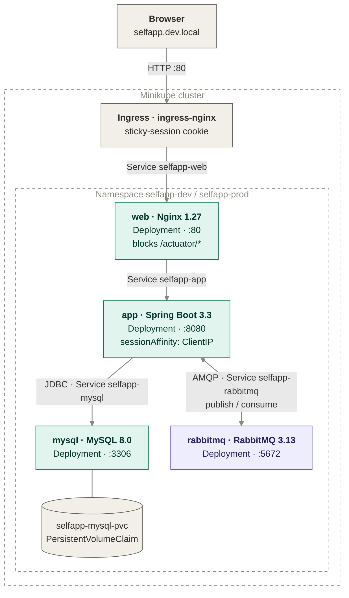

# k8s-selfapp-minikube

> The selfapp stack (Nginx → Spring Boot → MySQL, with RabbitMQ messaging) from
> [docker-buildlab-selfapp](https://github.com/alexiglesias/docker-buildlab-selfapp),
> deployed on Kubernetes with a single Helm chart. Runs locally on Minikube at zero cloud
> cost, in separate `dev` and `prod` namespaces. Passwords are generated per environment
> and never committed, only `/actuator/health` is reachable from outside the cluster,
> and every push is checked in CI with `helm lint`, `kubeconform` and `shellcheck`.

[](https://github.com/alexiglesias/k8s-selfapp-minikube/actions/workflows/ci.yml)
[](https://helm.sh/)
[](https://minikube.sigs.k8s.io/)
[](./charts/selfapp/templates)
[](./LICENSE)

## What's in here

A Helm chart that runs the same four services as the Docker Compose version, translated
into Kubernetes objects: Deployments for each service, Services for in-cluster DNS, an
Ingress as the single entry point, ConfigMaps for settings, Secrets for passwords and a
PersistentVolumeClaim for the MySQL data.

Two helper scripts wrap the whole flow: `deploy.sh` builds the images inside Minikube,
generates random passwords for the environment and installs the chart; `teardown.sh`
removes it, keeping the database unless you ask for a full purge.

What the chart takes care of:

- **Start-up order:** init containers keep the app waiting until MySQL and RabbitMQ
  accept connections, and startup probes give MySQL and Spring Boot time to boot without
  being restarted halfway through.
- **Self-healing:** readiness and liveness probes on every service.
- **Config changes roll out by themselves:** checksum annotations restart a pod when its
  ConfigMap or Secret changes.
- **Data safety:** the MySQL PVC survives `helm uninstall`
  (`helm.sh/resource-policy: keep`).
- **Two environments from one chart:** `values-dev.yaml` and `values-prod.yaml` (2
  replicas of app and web, pinned image tag, more resources).
- **Prometheus-ready:** the app pods carry `prometheus.io/*` annotations for
  [observability-selfapp](https://github.com/alexiglesias/observability-selfapp).

## Requirements

- **Docker Desktop** with at least **4 CPUs and 6 GB of memory** (Settings → Resources)
- **Minikube**, **kubectl** and **Helm 4** (`brew install minikube kubectl helm`)
- **docker-buildlab-selfapp** cloned **next to** this repo; `deploy.sh` builds the images
  from it:

```
Projects/
├── docker-buildlab-selfapp/
└── k8s-selfapp-minikube/
```

- *Optional:* `kubeconform` and `shellcheck` to run the CI checks locally

## Architecture



Only the Ingress is reachable from outside the cluster. Every other Service is
`ClusterIP`, so pods find each other by Service name through Kubernetes DNS
(`selfapp-mysql`, `selfapp-rabbitmq`, ...), the same way Compose containers find each
other by service name.

### Kubernetes objects

| Component | Objects | Notes |
|---|---|---|
| `mysql` | Secret, PVC, Deployment, Service | `Recreate` strategy so two MySQL pods never share the volume; startup probe allows up to 5 min for first-time setup |
| `app` | ConfigMap, Deployment, Service | Runs as non-root user 1001; init containers wait for MySQL and RabbitMQ; passwords come from the Secrets |
| `web` | ConfigMap, Deployment, Service | Same `selfapp.conf` as the Compose version, mounted over `default.conf` |
| `rabbitmq` | Secret, Deployment, Service | Credentials from a Secret (the default `guest` user can't connect from other pods) |
| Ingress | Ingress | `nginx` class from Minikube's ingress addon |

### Compose → Kubernetes

| docker-compose.yml | This chart |
|---|---|
| `environment:` | ConfigMap (settings) + Secret (passwords) |
| `depends_on: condition: service_healthy` | init containers + readiness probes |
| `healthcheck:` | startup, readiness and liveness probes |
| named volume `selfdb-data` | PersistentVolumeClaim |
| `ports: "80:80"` | Ingress |
| `.env` (git-ignored) | `<env>.secrets.yaml` (git-ignored, generated) |

## Quick start

```bash
# 1. Clone both repos side by side
git clone https://github.com/alexiglesias/docker-buildlab-selfapp.git
git clone https://github.com/alexiglesias/k8s-selfapp-minikube.git
cd k8s-selfapp-minikube

# 2. Start Minikube with the ingress addon
./scripts/minikube-up.sh

# 3. Build the images, generate passwords and install the chart
./scripts/deploy.sh dev

# 4. Make the Ingress reachable (macOS: keep this running in its own terminal)
minikube tunnel

# 5. Point the hostname at it (once)
echo "127.0.0.1 selfapp.dev.local" | sudo tee -a /etc/hosts

# 6. Check and open the app
kubectl get pods -n selfapp-dev
curl http://selfapp.dev.local/actuator/health      # {"status":"UP",...}
open http://selfapp.dev.local
```

On Linux you can usually skip `minikube tunnel` and use `$(minikube ip)` instead of
`127.0.0.1` in step 5.

## Application credentials

The same demo users as docker-buildlab-selfapp (in-memory, for learning only):

| User | Password | Role |
|---|---|---|
| `admin_self` | `admin_self` | ADMIN: add and delete users |
| `test_self` | `test_self` | USER: view only |

## Environments

| | dev | prod |
|---|---|---|
| Namespace | `selfapp-dev` | `selfapp-prod` |
| Hostname | `selfapp.dev.local` | `selfapp.local` |
| Image tag | `:dev`, `pullPolicy: Never` | `:v1` (pinned), `pullPolicy: IfNotPresent` |
| App / web replicas | 1 / 1 | 2 / 2 |
| MySQL volume | 1 Gi | 2 Gi |
| Passwords | `charts/selfapp/dev.secrets.yaml` | `charts/selfapp/prod.secrets.yaml` |

```bash
./scripts/deploy.sh prod
echo "127.0.0.1 selfapp.local" | sudo tee -a /etc/hosts
```

With the default 4 GB Minikube, run one environment at a time.

## Security

- **No passwords in Git.** `deploy.sh` generates `<env>.secrets.yaml` with random
  passwords (`openssl rand`, `chmod 600`) and refuses to run if Git wouldn't ignore it.
  `.helmignore` keeps the file out of `helm package` too.
- **Metrics stay inside the cluster.** The app serves `/actuator/prometheus` without
  login, so Nginx proxies only `/actuator/health` and returns 404 for every other
  `/actuator` path. Prometheus scrapes the app pods directly on `:8080`.
- **Non-root app.** The pod spec enforces `runAsNonRoot` and user 1001, matching the
  image.
- **Least-privilege CI.** The workflow has read-only permissions and pinned tool
  versions.

```bash
curl -s -o /dev/null -w "%{http_code}\n" http://selfapp.dev.local/actuator/prometheus   # 404
```

## Messaging with RabbitMQ

```bash
# Add a user in the web UI, then see the event being consumed
kubectl logs -n selfapp-dev deploy/selfapp-app | grep "received"

# The queue, as seen by the broker
kubectl exec -n selfapp-dev deploy/selfapp-rabbitmq -- rabbitmqctl list_queues
```

## How it's tested

**On every push and pull request** ([ci.yml](.github/workflows/ci.yml)):

| Check | What it catches |
|---|---|
| `shellcheck scripts/*.sh` | Common Bash mistakes in the scripts |
| `helm lint --strict` | Template and chart errors (dev, prod, RabbitMQ disabled) |
| `helm template \| kubeconform -strict` | Objects that aren't valid Kubernetes, e.g. a misspelled field |

**By hand on Minikube** before each change was merged:

- all pods `1/1` with no restarts after a clean install
- user creation publishes and consumes a `user.created` message
- `/actuator/prometheus` returns 404 through the Ingress and 200 inside the cluster
- changing a password with `--set rabbitmq.password=...` restarts only the app and
  RabbitMQ, and messaging keeps working
- `teardown.sh` keeps the users; `teardown.sh --purge` starts from an empty database
- prod with 2 app replicas keeps you logged in (sticky sessions)

## Troubleshooting

Problems I actually hit while building this, and their fixes:

| Problem | Cause and fix |
|---|---|
| App in `CrashLoopBackOff`, logs say `Unable to determine Dialect` | The app can't log in to MySQL. Check with `kubectl exec -n selfapp-dev deploy/selfapp-mysql -- mysql -uselfuser -p<password> -e "SHOW DATABASES;"`. If it says `Access denied`, MySQL's first-time setup was interrupted or the password changed after it ran (MySQL only reads it once). Fix: `./scripts/teardown.sh dev --purge`, then deploy again |
| MySQL restarts with `OOMKilled` | Memory limit too low for MySQL 8's first start. The chart uses 768 Mi; don't go below it |
| Old data comes back after deleting the PVC | Minikube's storage keeps files in `/tmp/hostpath-provisioner/<namespace>/` after the PVC is gone, and a new PVC with the same name reuses them. `teardown.sh --purge` deletes that folder too |
| `docker build` fails with `404 page not found` | `minikube docker-env` doesn't work with the containerd runtime. `deploy.sh` uses `minikube image build`, which works with any runtime |
| `failed calling webhook "validate.nginx.ingress.kubernetes.io"` | The ingress controller isn't ready yet (common right after a restart). Wait for it: `kubectl get pods -n ingress-nginx`, then deploy again |
| Logged out when adding a user in prod | Login sessions live in each app pod's memory. With 2 replicas, requests must keep reaching the same pod: the chart sets an Ingress cookie and `sessionAffinity: ClientIP` |
| `selfapp.dev.local` doesn't load on macOS | Minikube's IP isn't reachable from the Mac with the Docker driver. Run `minikube tunnel` and use `127.0.0.1` in `/etc/hosts` |
| Replica count doesn't change after `helm upgrade` | A manual `kubectl scale` took over the field. Change it through the values file instead, or scale back by hand once |

**After restarting your computer:** start Docker Desktop, run `minikube start`, wait for
the pods with `kubectl get pods -n selfapp-dev -w`, then start `minikube tunnel` again.

## Stop / reset

```bash
./scripts/teardown.sh dev            # uninstall, keep the database and namespace
./scripts/teardown.sh dev --purge    # delete everything, including all data
minikube stop                        # stop the cluster, keep everything
minikube delete                      # delete the whole cluster
```

## Known limitations

- **Sticky sessions, not shared sessions.** If an app pod dies, its users are logged
  out. The proper fix is storing sessions in MySQL with Spring Session (an app change).
- **Liveness includes MySQL and RabbitMQ.** `/actuator/health` reports DOWN when a
  dependency is down, so Kubernetes restarts the app even though restarting won't help.
  Spring's `/actuator/health/liveness` would avoid this, but the app's security config
  only makes `/actuator/health` public.
- **MySQL is a single Deployment**, not a StatefulSet or a replicated database.
- **Secrets are base64-encoded, not encrypted** at rest in Minikube's etcd.
- **No NetworkPolicies:** any pod in the namespace can reach any other.
- **Images are built locally**, not pulled from a registry.

## Why Minikube

The point of this project is learning Kubernetes and Helm without a cloud bill. A
managed control plane such as AWS EKS costs $0.10/hour (about $73/month) before any
worker nodes. Minikube runs the same Kubernetes API on a laptop for free, and the chart
itself isn't tied to Minikube: change the image repositories, the storage class and the
ingress class, and it installs on any cluster.

## Project layout

```
k8s-selfapp-minikube/
├── .github/
│   ├── workflows/ci.yml            # shellcheck, helm lint, kubeconform (dev, prod, rabbitmq off)
│   └── dependabot.yml              # weekly updates for GitHub Actions
├── charts/selfapp/
│   ├── Chart.yaml
│   ├── .helmignore                 # keeps *.secrets.yaml out of helm package
│   ├── values.yaml                 # shared defaults
│   ├── values-dev.yaml             # dev: local :dev images, 1 replica
│   ├── values-prod.yaml            # prod: pinned :v1, 2 replicas, more resources
│   └── templates/
│       ├── _helpers.tpl            # name and label helpers
│       ├── NOTES.txt               # printed after install
│       ├── mysql-secret.yaml       mysql-pvc.yaml      mysql-deployment.yaml   mysql-service.yaml
│       ├── app-configmap.yaml      app-deployment.yaml app-service.yaml
│       ├── web-configmap.yaml      web-deployment.yaml web-service.yaml
│       ├── rabbitmq-secret.yaml    rabbitmq-deployment.yaml rabbitmq-service.yaml
│       └── ingress.yaml
├── scripts/
│   ├── minikube-up.sh              # start Minikube + ingress addon
│   ├── deploy.sh                   # build images, generate passwords, helm upgrade --install
│   └── teardown.sh                 # uninstall (keeps data) or --purge
├── LICENSE
└── README.md
```

## Related projects

Part of the selfapp series:

- [`docker-buildlab-selfapp`](https://github.com/alexiglesias/docker-buildlab-selfapp):
  the app itself, its Dockerfiles and the Docker Compose stack this chart is based on
- [`cicd-github-actions-selfapp`](https://github.com/alexiglesias/cicd-github-actions-selfapp):
  CI/CD pipeline that tests, builds, scans and deploys the images
- [`observability-selfapp`](https://github.com/alexiglesias/observability-selfapp):
  Prometheus, Grafana, Loki and Slack alerts for this app

## License

[MIT](./LICENSE)
